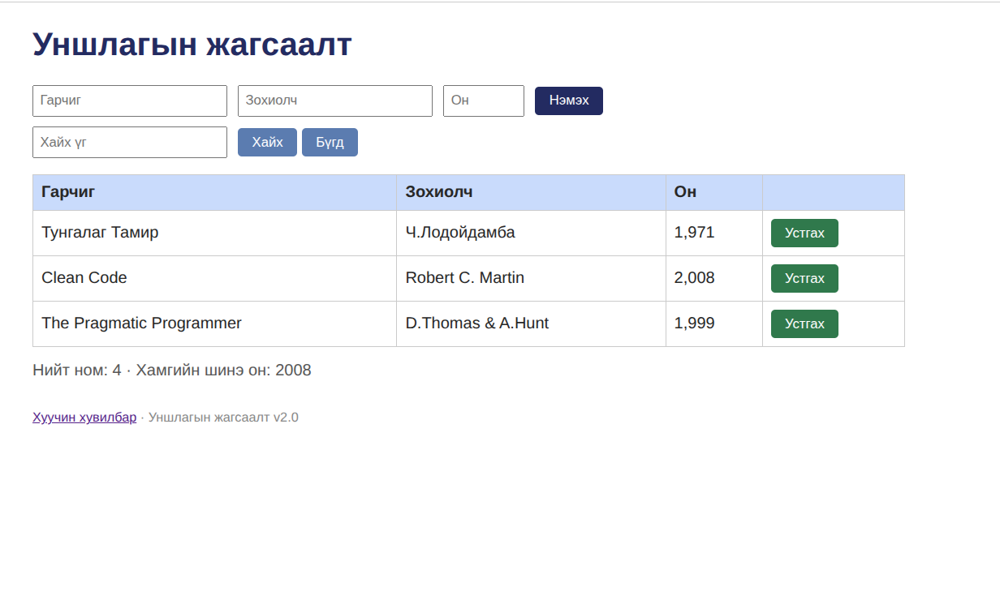

# BUG-01: Хуудас нээхэд «Нийт ном» тоолуур хүснэгтийн мөрийн тооноос 1-ээр их харагдана

Орчин:  Уншлагын жагсаалт v2.0, Google Chrome 154.0.8037.97 , Ubuntu Linux, 2026-10-20

Урьдчилсан нөхцөл: node app.js-ийг шинээр асаасан (анхны 3 ном)

## Дахин гаргах алхам

1. Терминалд `node app.js` ажиллуул.
2. Chrome дээр http://localhost:3000 нээ.
3. Хүснэгтийн мөр, түүний доорх «Нийт ном» тоог тулга.

Хүлээгдэж байсан: «Нийт ном» тоолуур хүснэгтэд буй номын тоотой тэнцүү (спецификаци). Энд 3.
Бодит үр дүн:     Хүснэгтэд 3 мөр байхад «Нийт ном: 4» гэж харагдана.
Ноцтой байдал: Minor — өгөгдөл алдагдахгүй, харин хэрэглэгчид буруу тоо харуулна.

Хавсралт:      screenshots/bug-01-fresh.png
Олдсон аялал:  Supermodel (GUI)
