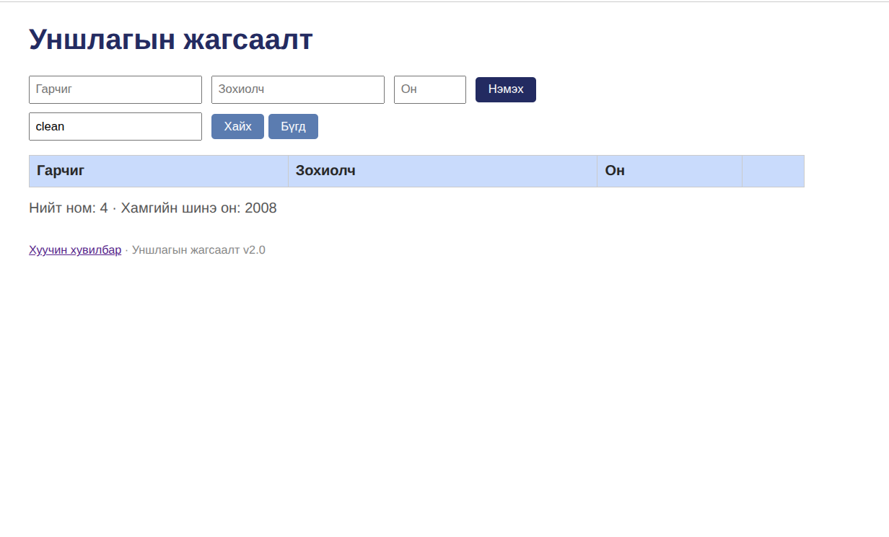
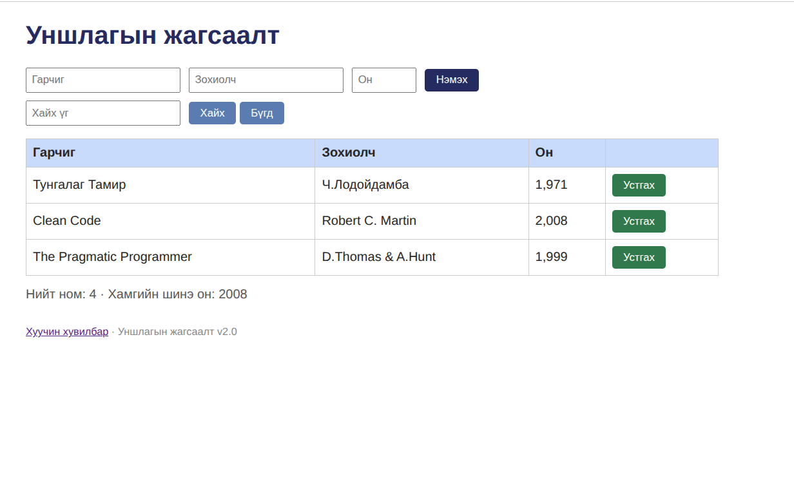

# BUG-07: Хайлт жижиг үсгээр бичихэд ном олдохгүй, том үсгээр олдоно

Орчин:  Уншлагын жагсаалт v2.0, Google Chrome 154.0.8037.97, Ubuntu Linux, 2026-10-20

Урьдчилсан нөхцөл: node app.js-ийг шинээр асаасан (анхны 3 ном)

## Дахин гаргах алхам

1. Терминалд `node app.js` ажиллуул, Chrome дээр http://localhost:3000 нээ.
2. «Хайх үг» талбарт `clean` гэж бичээд «Хайх» дар.
3. Талбарт `Clean` гэж бичээд «Хайх» дар.

Хүлээгдэж байсан: Хайлт гарчиг, зохиолчоос хайх ба том/жижиг үсэг ЯЛГАХГҮЙ (спецификаци). Хоёр хайлтад Clean Code олдох ёстой.
Бодит үр дүн:     `clean` гэхэд хүснэгт хоосон; `Clean` гэхэд Clean Code олдоно.
Ноцтой байдал: Major — хайлтын үндсэн үйлдэл том/жижиг үсгээс болж ажиллахгүй.

Хавсралт:      screenshots/bug-07.png, screenshots/bug-07-clean-capital.png
Олдсон аялал:  Supermodel (GUI)
